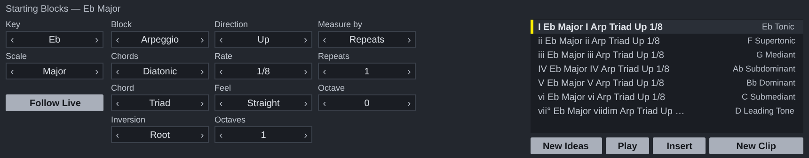

# Starting Blocks for Ableton Live

A Max for Live MIDI effect. The music comes from `reascripts/sb_engine.lua`,
the same file the REAPER script runs, unchanged.

## Installing

Needs **Live 12.1 or later with Max for Live** (Live Suite, or Standard with
the add-on), because the device runs on Max 9's JavaScript engine (`[v8ui]`).

1. Copy the three files `Starting Blocks.amxd`, `StartingBlocks.js` and
   `StartingBlocks.maxpat` into one folder, for example
   `Music/Ableton/User Library/Presets/MIDI Effects/Max MIDI Effect/`.
   The `.amxd` finds `StartingBlocks.js` beside it.
2. Drag `Starting Blocks.amxd` onto a MIDI track, in front of an instrument.
3. Optional: open it in the Max editor and click **Freeze Device**, then save.
   The device then carries the script inside it and can be moved on its own.

## Using it

| | |
| --- | --- |
| **Key**, **Scale** | The key the blocks are written in. **Follow Live** keeps it on Live's scale (the Scale button in the clip view) when that scale is one ScaleView knows. |
| The middle | The engine's settings: Block, Chords, Inversion, Rate and the rest. Only the ones that apply are shown. Click the right of a value for the next, the left for the one before, or drag up and down. |
| The list | One block per degree of the key. Click one to hear it on the track's instrument. |
| **Play** | Plays the chosen block again, or stops it. |
| **Insert** | Puts the chosen block where the button beside it says: **New Clip** (the first free slot on this track, from the selected scene down), **Arrangement** (at the insert marker; Live 12.2 or later) or **This Clip** (in place of the notes of the clip open in Detail View). One undo step. |

The settings and the key are saved with the Live set.

## How it is built

`ableton/device.json` describes the device; `python3 ableton/kit/build.py
ableton/device.json` writes the `.amxd`, the `.maxpat` and the script bundle
`StartingBlocks.js`. The bundle is Middaw's Lua 5.4 runtime, the engine, the
Noterator adapter (`ableton/adapters/`) and the shared window
(`ableton/kit/generator.js`). See `ableton/kit/VENDORED.md`.

`node --test ableton/tests/test_device.js` runs the device on a pretend Max
and a pretend Live set: every setting, hearing a block, each way of inserting,
following Live's scale, and saving. `node ableton/window.js` redraws the picture above from the device's own drawing code (it needs Playwright's Chromium).

## Limits

- **It has not been opened in Live yet.** Everything above is tested in Node
  against a stand-in for Max and the Live Object Model; nothing has run in Max.
  If the `.amxd` will not open, open `StartingBlocks.maxpat` in Max instead and
  save it as a device.
- Blocks are heard on whatever instrument is after the device, a few
  milliseconds late at worst: Max's JavaScript runs off the audio thread.
- The VST3/CLAP plugin on the `plugin` branch also runs in Live and keeps the
  REAPER window exactly; this device is the Live-native alternative.
